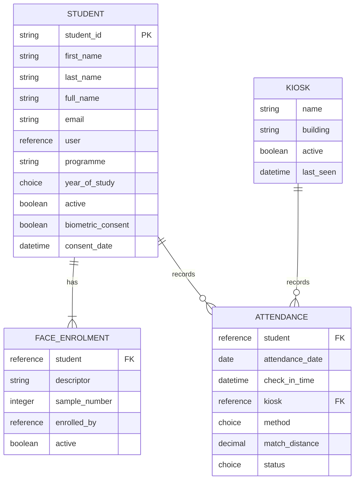

# IKWA Task – Student Attendance Kiosk with Face Recognition

## 1. Part 1: Data Model

### 1.1 Overview – Student Attendance Kiosk Data Model

## 1.1 Overview – Student Attendance Kiosk Data Model

The Student Attendance Kiosk application uses four main tables to manage student information, face enrolment, kiosk configuration, and attendance records.

### Data Model Diagram



### Table Relationships

- One student can have 1 to 3 face enrolment samples.
- One student can have multiple attendance records.
- Each attendance record is associated with one student and one kiosk.
- The attendance record stores the date, check-in time, method, match distance, and status.


### 1.2 Student Table:
tanle  : x_ikwa_campus_at_0_student


### 1.3 Face Enrolment Table
table : x_ikwa_campus_at_0_face_enrolment


### 1.4 Kiosk Table
table : x_ikwa_campus_at_0_kiosk


### 1.5 Attendance Table (setted read only)
table : x_ikwa_campus_at_0_attendance


### 1.6 Roles and ACLs

## 1.6 Roles and ACLs

### ACL Permissions Required

The following Access Control Lists (ACLs) are configured for the Student Attendance Kiosk application.

| Table | Role | Permission |
|---|---|---|
| Student | `attendance.admin` | Read, Create, Write, Delete |
| Student | `attendance.kiosk` | Read |
| Student | `attendance.viewer` | Read |
| Face Enrolment | `attendance.admin` | Read, Create, Write, Delete |
| Kiosk | `attendance.admin` | Read, Create, Write, Delete |
| Kiosk | `attendance.kiosk` | Read |
| Kiosk | `attendance.viewer` | Read |
| Attendance | `attendance.admin` | Read, Create, Write, Delete |
| Attendance | `attendance.kiosk` | Create |
| Attendance | `attendance.viewer` | Read |

### Field-Level ACL

A field-level Read ACL is configured for the Face Enrolment table.

| Table | Field | Role | Permission |
|---|---|---|---|
| Face Enrolment | `descriptor` | `attendance.admin` | Read |

### ACL Security Implementation

- Attendance administrators have full access to all four tables.
- Kiosk users can read Student and Kiosk records.
- Kiosk users can create Attendance records.
- Viewer users have read-only access to Student, Kiosk, and Attendance records.
- Only users with the `attendance.admin` role can read the stored face descriptor.

### ACL Configuration Screenshot


### 1.7 Test Data
<!-- Add screenshot here -->

## 2. Part 2: Script Include – AttendanceMatcher

### 2.1 AttendanceMatcher Script Include


```
var AttendanceMatcher = Class.create();
AttendanceMatcher.prototype = {
    MATCH_THRESHOLD: 0.5,
    DESCRIPTOR_LENGTH: 128,

    SCOPE: 'x_ikwa_campus_at_0',
    T_STUDENT: 'x_ikwa_campus_at_0_student',
    T_ENROL: 'x_ikwa_campus_at_0_face_enrolment',
    T_KIOSK: 'x_ikwa_campus_at_0_kiosk',
    T_ATT: 'x_ikwa_campus_at_0_attendance',
    ROLE_ADMIN: 'x_ikwa_campus_at_0.admin',
    ROLE_KIOSK: 'x_ikwa_campus_at_0.kiosk',

    initialize: function() {},

    /**
     * Find the closest enrolled student and mark them present for today.
     * Returns { status: 'present' | 'already' | 'unknown' | 'error', name, time, message }
     */
    identifyAndMark: function(descriptor, kioskId) {
        if (!(gs.hasRole(this.ROLE_KIOSK) || gs.hasRole(this.ROLE_ADMIN)))
            return { status: 'error', message: 'Not authorised' };

        if (!this._isValidDescriptor(descriptor))
            return { status: 'error', message: 'Invalid face data' };

        var kiosk = new GlideRecord(this.T_KIOSK);
        if (!kioskId || !kiosk.get(kioskId) || kiosk.getValue('active') != '1')
            return { status: 'error', message: 'Unknown or inactive kiosk' };
        kiosk.setValue('last_seen', new GlideDateTime());
        kiosk.update();

        var best = this._findBestMatch(descriptor);
        if (!best || best.distance > this.MATCH_THRESHOLD)
            return { status: 'unknown' };

        return this._markPresent(best.studentId, kioskId, best.distance);
    },

    /**
     * Save 1-3 descriptors for a student. Refuses if the student has not consented.
     */
    enrol: function(studentId, descriptors) {
        if (!gs.hasRole(this.ROLE_ADMIN))
            return { status: 'error', message: 'Not authorised' };

        var student = new GlideRecord(this.T_STUDENT);
        if (!studentId || !student.get(studentId))
            return { status: 'error', message: 'Student not found' };

        if (student.getValue('biometric_consent') != '1')
            return { status: 'error', message: 'No consent' };
        if (student.getValue('active') != '1')
            return { status: 'error', message: 'Student is not active' };

        if (!descriptors || typeof descriptors.length != 'number' ||
            descriptors.length < 1 || descriptors.length > 3)
            return { status: 'error', message: 'Provide 1 to 3 samples' };
        for (var i = 0; i < descriptors.length; i++) {
            if (!this._isValidDescriptor(descriptors[i]))
                return { status: 'error', message: 'Invalid face data in sample ' + (i + 1) };
        }

        var old = new GlideRecord(this.T_ENROL);
        old.addQuery('student', studentId);
        old.addQuery('active', true);
        old.query();
        while (old.next()) {
            old.setValue('active', false);
            old.update();
        }

        var count = 0;
        for (var j = 0; j < descriptors.length; j++) {
            var rounded = [];
            for (var k = 0; k < this.DESCRIPTOR_LENGTH; k++)
                rounded.push(Number(Number(descriptors[j][k]).toFixed(5)));

            var gr = new GlideRecord(this.T_ENROL);
            gr.initialize();
            gr.setValue('student', studentId);
            gr.setValue('descriptor', JSON.stringify(rounded));
            gr.setValue('sample_number', j + 1);
            gr.setValue('enrolled_by', gs.getUserID());
            gr.setValue('active', true);
            if (gr.insert())
                count++;
        }

        return { status: 'enrolled', count: count };
    },

    getStudentInfo: function(studentId) {
        if (!gs.hasRole(this.ROLE_ADMIN))
            return null;

        var s = new GlideRecord(this.T_STUDENT);
        if (!studentId || !s.get(studentId))
            return null;

        return {
            student_id: s.getValue('student_id'),
            full_name:  s.getValue('full_name'),
            email:      s.getValue('email'),
            programme:  s.getValue('programme'),
            consent:    s.getValue('biometric_consent') == '1'
        };
    },

    /** Test match button on the enrolment page */
    testMatch: function(studentId, descriptor) {
        if (!gs.hasRole(this.ROLE_ADMIN))
            return { status: 'error', message: 'Not authorised' };
        if (!this._isValidDescriptor(descriptor))
            return { status: 'error', message: 'Invalid face data' };

        var gr = new GlideRecord(this.T_ENROL);
        gr.addQuery('student', studentId);
        gr.addQuery('active', true);
        gr.query();

        var best = null;
        while (gr.next()) {
            var d = this._distance(descriptor, JSON.parse(gr.getValue('descriptor')));
            if (best === null || d < best)
                best = d;
        }
        if (best === null)
            return { status: 'error', message: 'No active enrolment for this student' };

        return { status: 'ok', distance: Number(best.toFixed(3)), match: best <= this.MATCH_THRESHOLD };
    },

    _findBestMatch: function(descriptor) {
        var best = null;
        var gr = new GlideRecord(this.T_ENROL);
        gr.addQuery('active', true);
        gr.addQuery('student.active', true);
        gr.addQuery('student.biometric_consent', true);
        gr.query();
        while (gr.next()) {
            var stored;
            try {
                stored = JSON.parse(gr.getValue('descriptor'));
            } catch (e) {
                continue;   // skip a damaged record
            }
            if (!this._isValidDescriptor(stored))
                continue;

            var distance = this._distance(descriptor, stored);
            if (!best || distance < best.distance)
                best = { studentId: gr.getValue('student'), distance: distance };
        }
        return best;
    },

    _markPresent: function(studentId, kioskId, distance) {
        var student = new GlideRecord(this.T_STUDENT);
        if (!student.get(studentId))
            return { status: 'error', message: 'Student not found' };
        var name = student.getValue('full_name');
        var today = new GlideDate().getValue();

        var att = new GlideRecord(this.T_ATT);
        att.addQuery('student', studentId);
        att.addQuery('attendance_date', today);
        att.setLimit(1);
        att.query();
        if (att.next())
            return { status: 'already', name: name, time: this._timeOnly(att.getDisplayValue('check_in_time')) };

        att.initialize();
        att.setValue('student', studentId);
        att.setValue('attendance_date', today);
        att.setValue('check_in_time', new GlideDateTime());
        att.setValue('kiosk', kioskId);
        att.setValue('method', 'face');
        att.setValue('match_distance', Number(distance.toFixed(4)));
        att.setValue('status', 'present');
        if (!att.insert())
            return { status: 'error', message: 'Could not save attendance' };

        return { status: 'present', name: name, time: this._timeOnly(att.getDisplayValue('check_in_time')) };
    },

    _distance: function(a, b) {
        var sum = 0;
        for (var i = 0; i < a.length; i++)
            sum += (a[i] - b[i]) * (a[i] - b[i]);
        return Math.sqrt(sum);
    },

    _isValidDescriptor: function(d) {
        if (!d || typeof d.length != 'number' || d.length != this.DESCRIPTOR_LENGTH)
            return false;
        for (var i = 0; i < d.length; i++) {
            var v = d[i];
            if (v === null || v === '' || !isFinite(Number(v)))
                return false;
        }
        return true;
    },

    /** "2026-11-05 09:02:00" -> "09:02" (keeps AM/PM if the user format has it) */
    _timeOnly: function(display) {
        var m = String(display || '').match(/(\d{1,2}:\d{2})(?::\d{2})?\s*(AM|PM)?/i);
        return m ? m[1] + (m[2] ? ' ' + m[2] : '') : String(display || '');
    },

    type: 'AttendanceMatcher'
};
```

### 2.2 Face Matching Logic
<!-- Add screenshot here -->

### 2.3 Attendance Record Creation
<!-- Add screenshot here -->

### 2.4 Duplicate Attendance Prevention
<!-- Add screenshot here -->

### 2.5 Performance Testing
<!-- Add screenshot here -->

## 3. Part 3: Service Portal

### 3.1 Portal Configuration (CAmpus Attendance)  
sp_portal.list


### 3.2 Portal Pages  ( added 1 extra for homepage)
sp_page.list


### 3.3 Widget Dependency – face-api.js


## 4. Part 4: Widgets  (update code here later)

add extra page for Home 


### 4.1 Attendance Kiosk Widget


### 4.2 Face Enrolment Widget


### 4.3 Attendance Dashboard Widget


## 5. Part 5: Kiosk Setup (live test is better)

### 5.1 Kiosk Device Configuration
<!-- Add screenshot here -->

### 5.2 Kiosk URL Configuration
<!-- Add screenshot here -->

### 5.3 Full-Screen Kiosk Mode
<!-- Add screenshot here -->

## 6. Part 6: Test Plan

### 6.1 T1 – Enrolled Student Attendance
<!-- Add screenshot here -->

### 6.2 T2 – Duplicate Attendance Prevention
<!-- Add screenshot here -->

### 6.3 T3 – Unknown Person Detection
<!-- Add screenshot here -->

### 6.4 T4 – Student Without Consent
<!-- Add screenshot here -->

### 6.5 T5 – Biometric Consent Disabled
<!-- Add screenshot here -->

### 6.6 T6 – Multiple Face Detection
<!-- Add screenshot here -->

### 6.7 T7 – Kiosk URL with Inactive Kiosk
<!-- Add screenshot here -->

### 6.8 T8 – Camera Permission Blocked
<!-- Add screenshot here -->

### 6.9 T9 – Dashboard Live Updates
<!-- Add screenshot here -->

### 6.10 T10 – Access Control Validation
<!-- Add screenshot here -->

### 6.11 T11 – Phone Photo Detection Limitation
<!-- Add screenshot here -->

### 6.12 Match Distance Threshold Testing
<!-- Add screenshot here -->

## 7. Deliverables

### 7.1 Scoped Application
<!-- Add screenshot here -->

### 7.2 README Documentation
<!-- Add screenshot here -->

### 7.3 15-Minute Demo
<!-- Add screenshot here -->

## 8. Acceptance Criteria

### 8.1 Application Scope Validation
<!-- Add screenshot here -->

### 8.2 Face Image Storage Validation
<!-- Add screenshot here -->

### 8.3 Biometric Consent Validation
<!-- Add screenshot here -->

### 8.4 Duplicate Attendance Validation
<!-- Add screenshot here -->

### 8.5 Unknown Person Validation
<!-- Add screenshot here -->

### 8.6 Kiosk Recovery Validation
<!-- Add screenshot here -->

### 8.7 Dashboard Live Update Validation
<!-- Add screenshot here -->

### 8.8 AttendanceMatcher Logic Validation
<!-- Add screenshot here -->

## 9. Optional Stretch Goals

### 9.1 Late Attendance Detection
<!-- Add screenshot here -->

### 9.2 Absence Alert Flow
<!-- Add screenshot here -->

### 9.3 Blink Detection – Basic Liveness Check
<!-- Add screenshot here -->

### 9.4 Manual Check-In
<!-- Add screenshot here -->

### 9.5 Cloud Comparison – AWS Rekognition
<!-- Add screenshot here -->
